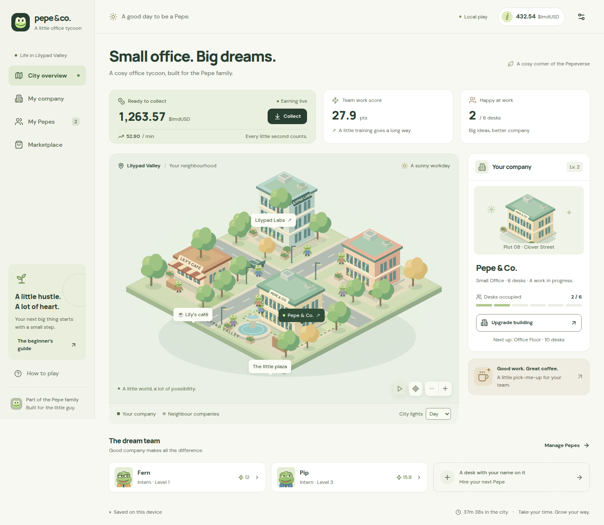

# Pepe & Co.

A playable, cosy office tycoon for the Pepe family. Start with a free Pepe, open a company, hire your team, collect earnings, and grow a garage into a headquarters.

The finished static site is in **`dist/`**. It includes all fonts, illustrations, icons, metadata, and the social preview image. No backend, external asset host, or private credentials are required.



## Play

1. Choose **Start playing**, mint your free first Pepe, and name your company.
2. Open the garage for 250 of the starting 1,200 simulated $ImdUSD and hire your Pepe.
3. Earnings accumulate every second. **Collect** moves them into your balance.
4. Train workers, upgrade the building, mint more Pepes, or buy trained workers in the marketplace.
5. Visit Lily’s café for a timed earnings boost. Explore the city labels, switch day/night lighting, pause movement, or zoom the map.

The four pages are City overview, My company, My Pepes, and Marketplace. The company page explains the earnings formula, building progression, recent activity, and play time. Worker filters, role filters, empty states, affordability messages, and upgrade/training limits are functional.

**Local play:** This delivery is a browser game demonstrating the requested NFT/token economy. Pepes and $ImdUSD are simulated records, not on-chain assets; there is no wallet, authentication service, real payout, or live multiplayer. Neighbour buildings are illustrated scenery. These limits are also explained in onboarding, Help, and Settings. No chain, contract, recipient, or key has been invented.

Progress is saved in this browser’s local storage under `pepe-and-co-save-v1`. Returning players receive at most eight hours of offline earnings. Settings can download a JSON record or reset progress after confirmation. The download is an inspectable save record; an import/restore interface is not implemented. Clearing site data removes local progress. Use one active play tab for predictable results; cross-tab synchronization is best effort, not transaction locking.

## Install and develop

Use Node **22.12 or newer** and npm. The delivered lockfile pins the dependency tree.

```sh
npm ci
npm run dev
```

Open the URL printed by Vite. The implementation uses React, TypeScript, Vite, locally bundled Lucide icons, and original SVG city/character artwork. There is no environment-file setup.

## Preview the delivered export

The export can be served without installing dependencies:

```sh
python3 -m http.server 4173 --directory dist
```

Open `http://localhost:4173/`. Serve over HTTP rather than opening `index.html` with `file://`.

After installation, Vite can also preview it:

```sh
npm run preview -- --port 4173
```

## Rebuild and check

```sh
npm run typecheck
npm test
npm run build
npm run check:export
```

`build` replaces `dist/`. `check:export` checks metadata, local relative asset references, missing files, the 1200 × 630 social image, and the export size. `test` runs 17 deterministic game-model tests. No test uses real-time waiting for the eight-hour cap or the upgrade cooldown.

`npm run social:svg` regenerates the editable social SVG from the shared city art. If that artwork changes, render `public/og-image.svg` at 1200 × 630 to update the accompanying PNG before rebuilding. The required PNG is already included; ordinary builds do not need a screenshot renderer.

During this assignment, dependencies were installed in `/tmp/pepe-office-build`, outside the repository, to respect its path restrictions. The checked source, public files, configuration, tests, manifest, and lockfile were mirrored byte for byte there; the resulting export was copied back. No dependency directory or package cache is part of this submission.

## Publish

Publish the **contents of `dist/`**, including its `assets/` and `fonts/` directories, to a static host or an IPFS directory. Keep `index.html` at the published directory root. The assignment publisher can serve this delivered export directly; it does not need to rebuild it.

Vite’s base is `./`, all exported assets are relative and local, and navigation uses URL hashes. No server route rewrites are needed. The production export was checked at the nested path `/preview/`, not only at a domain root. No deployment or publishing command was run for this assignment.

Open Graph metadata includes a relative local image so the export remains portable. Actual social-network unfurling was not tested; a publisher with a stable public origin may optionally resolve that image URL to its absolute public URL for crawlers that require one.

## Implemented economy

Amounts and balancing are editable in `src/game.ts`.

| Building | Desks | Base $ImdUSD/min | Cost to reach |
| --- | ---: | ---: | ---: |
| Garage | 3 | 10 | 250 to open company |
| Small Office | 6 | 25 | 600 |
| Office Floor | 10 | 60 | 1,500 |
| Office Tower | 18 | 140 | 4,500 |
| Headquarters | 30 | 300 | 12,000 |

- Earnings per minute = **(building base + employed workers’ scores) × boosts**. Accrual settles before an action changes the rate; collection preserves fractions of a cent.
- Starting scores: Intern 12, Analyst 22, Developer 35, Manager 50, CEO 80. Later mints cost 300, with role probabilities of 45%, 30%, 15%, 8%, and 2%. The free first mint is a guaranteed Intern.
- Training raises the underlying score by 15% per level, displayed to one decimal, up to level 10. The next level costs `ceil(60 × 1.65^(level − 1))`.
- Upgrades have a 60-second cooldown. Coffee costs 60 and applies a 1.25× multiplier for five minutes, with correct accrual across expiry.
- A worker occupies at most one desk. Releasing or selling does not erase training. Working Pepes and the last owned Pepe cannot be sold; a repurchased worker retains the same identity, appearance, role, and level.
- Day/night alternates every four minutes of active play in Auto mode. This is a scene cycle, not a real-world calendar simulation.

The local state and device clock are editable by the player. The economy is not authoritative or suitable for real-value assets. Future on-chain ownership, secure accrual, marketplace settlement, and multiplayer would require a separate specified backend/contract design.

## Validation and design

Actual worker-run results, last rerun on 11 October 2026 (UTC) after the final source change:

| Check | Result |
| --- | --- |
| TypeScript `tsc --noEmit` | Passed |
| Game-model tests | 17 passed, 0 failed |
| Vite production build | Passed; 11 exported files, 719,147 bytes; `dist/` hashes match `artifacts/export-manifest.json` |
| Static export validation | Passed; six local relative asset references; 1200 × 630 PNG |
| Browser interactions | Onboarding, hiring, collection, training, upgrade/cooldown, minting, selling/repurchasing, filters, boost, navigation, reset, and download exercised |
| Responsive layout | All four pages at 320, 390, 768, 1024, 1440, and 1920 px; no document horizontal overflow |
| Accessibility scanner | Eight WCAG A/AA scans across desktop/mobile: 0 reported violations; illustrated-element contrast cases require manual interpretation |
| Final app load | 0 console errors/warnings; local runtime requests successful (HTTP 200/304) |

See [the complete review and limitations](artifacts/validation.md), [actual command output](artifacts/check-results.txt), [accessibility results](artifacts/accessibility-audit.json), and [layout measurements](artifacts/layout-audit.json). These are worker observations, not an independent certification. Native screen readers, real mobile hardware, Safari/Firefox, native browser zoom, and actual social unfurling were not tested.

[DESIGN.md](DESIGN.md) documents the final tokens, typography, components, and responsive behavior. Screenshots in `artifacts/` show the real rendered production build. Dependency and guidance attribution is in [THIRD_PARTY_NOTICES.md](THIRD_PARTY_NOTICES.md).

## Files and submission size

| Path | Purpose |
| --- | --- |
| `src/App.tsx` | Pages, dialogs, input validation, persistence, navigation |
| `src/game.ts` | Typed game state, accrual, actions, save validation |
| `src/components/` | Original city, buildings, Pepe portraits, brand mark |
| `src/styles.css` | Design tokens, component styles, responsive and accessibility rules |
| `public/` | Fonts, notices, favicon, social assets |
| `test/game.test.ts` | Deterministic economy and persistence checks |
| `scripts/` | Static-export validation and social SVG generation |
| `dist/` | Complete production website, ready to serve |
| `artifacts/` | Validation report, results, screenshots, size inventory |

The complete deliverable is below the assignment’s 8 MiB limit; the measured file inventory is in `artifacts/submission-size.json`. `dist/` is intentionally included. `.gitignore` has an explicit **512-byte path budget** and excludes generated dependency/cache directories at every nesting level. No submodule, npm registry mirror, dependency archive, source map, or temporary audit script is shipped.
